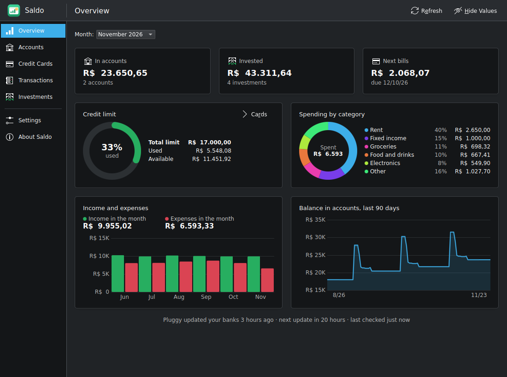
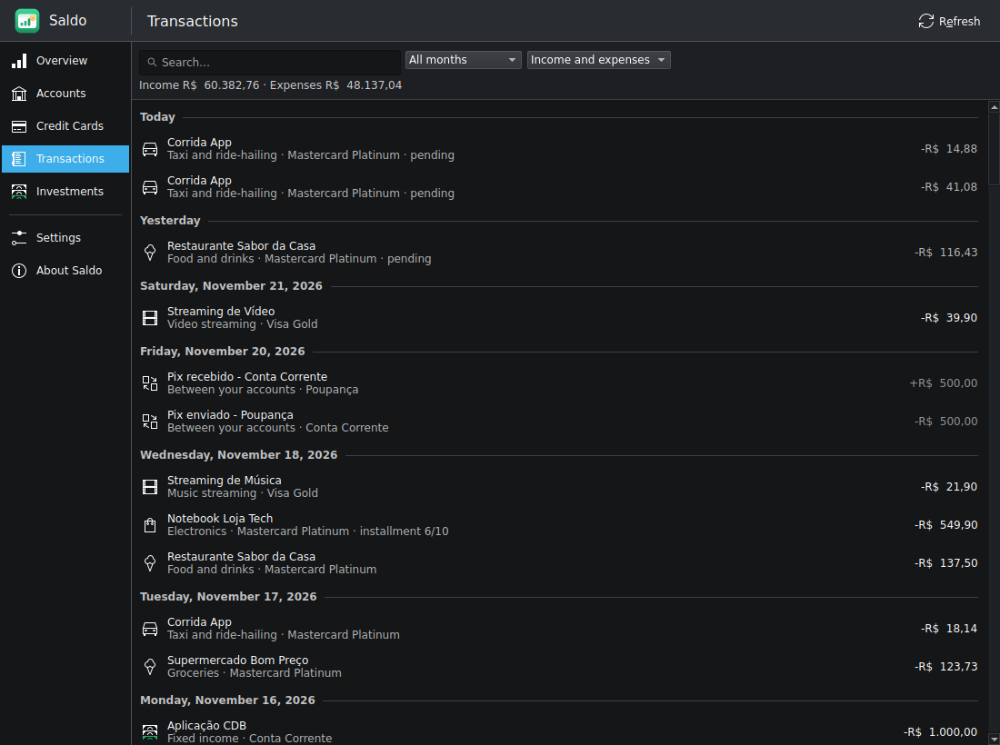

# Saldo

A Kirigami app and Plasma 6 widget for your personal finances. Saldo reads your banks
through the free **Meu Pluggy** personal-use API and shows bank balances, credit card
limits (overall and per card), bills, investments and transactions, with charts.

Built with Qt6 + QML + Kirigami (KDE Frameworks 6). No accounts, no servers: the app
talks to Pluggy directly, keeps your credentials in the system keyring and caches the
data locally.



|  |  |  |
| --- | --- | --- |
|  |  |  |

## Install

### Fedora (RPM)

Built for the current Fedora release. Download the latest `.rpm` from the
[Releases page](https://github.com/hernique33comiitei/saldo/releases/latest) and install it:

```sh
sudo dnf install ./saldo-*.x86_64.rpm
```

### Ubuntu / Debian (DEB)

Built on Ubuntu 26.04 LTS (needs Qt 6.8 and KDE Frameworks 6). Download the latest `.deb` from
the [Releases page](https://github.com/hernique33comiitei/saldo/releases/latest) and install it
(apt pulls in the dependencies):

```sh
sudo apt install ./saldo_*_amd64.deb
```

### Android (APK)

Download `saldo-<version>-arm64-v8a.apk` from the [Releases page](https://github.com/hernique33comiitei/saldo/releases/latest)
on your phone and open it (Android asks to allow installing apps from your browser once).

### From source (Fedora)

For development, or to build the current `main`:

```sh
./install.sh                    # installs missing deps, builds, installs to ~/.local
./install.sh --restart-plasma   # same, then reloads plasmashell so the widget appears
```

`install.sh` only asks for `sudo` the first time, to install missing packages. It also
writes `~/.config/plasma-workspace/env/saldo.sh` so plasmashell finds the widget's QML
plugin under `~/.local`. `./uninstall.sh` reverts it (`--purge` also deletes the cache,
preferences and keyring entry).

Try it without an account: `saldo --demo`.

### From source (other distributions)

Install the build dependencies, then build and install with CMake:

- Debian/Ubuntu: `cmake ninja-build extra-cmake-modules gettext qt6-base-dev qt6-declarative-dev
  libqt6sql6-sqlite libkirigami-dev libkf6i18n-dev libkf6coreaddons-dev`
- Fedora (what `install.sh` installs): `cmake ninja-build gcc-c++ extra-cmake-modules gettext
  qt6-qtbase-devel qt6-qtdeclarative-devel kf6-kirigami-devel kf6-ki18n-devel kf6-kcoreaddons-devel`

```sh
cmake -B build -G Ninja -DCMAKE_INSTALL_PREFIX=/usr && cmake --build build
sudo cmake --install build
```

At runtime it also needs the Kirigami and KQuickCharts QML modules, Qt SVG and the Qt SQLite
driver (the packages above pull most of them in) and `secret-tool`.

## Connect Meu Pluggy

Saldo opens a step-by-step guide on first run (*Connect Meu Pluggy* in the sidebar) that
walks through the steps below with the exact button names of Pluggy's dashboard.

Personal use gives you a **Client ID**, a **Client Secret** and one **item ID** per
connected bank (there is no single token):

1. Create an account at [meu.pluggy.ai](https://meu.pluggy.ai) and connect your banks.
2. At [dashboard.pluggy.ai](https://dashboard.pluggy.ai) (in Portuguese), open
   “Aplicações”: copy your application's **Client ID**, and its **Client Secret** (shown only
   once; otherwise “Credenciais” → “Gerar novo secret”).
3. Press ▶ “Iniciar Demo”, click “Conectar Conta”, pick **MeuPluggy** (not your bank), sign in
   and pick **one** bank under “Selecione a conta”. Each authorization shares a single bank:
   repeat for every bank you want (up to 5).
4. Copy the **id** of each item under “Itens Conectados” and paste it in Saldo, together with
   the Client ID and Secret (the guide, or *Settings*).

Guide: <https://docs.pluggy.ai/pt/docs/guides/meu-pluggy-personal-use>

- Meu Pluggy refreshes your banks **once a day** on its own and can't be forced; *Refresh*
  re-reads what Pluggy already has.
- Authorizations last one year (Saldo warns 30 days before). Renewing may change the item ID.

## Plasma widget

Right-click the panel → *Add or Manage Widgets* → **Saldo**, or *Configure System Tray →
Entries → Saldo*. The panel shows the Saldo icon or, optionally, the money in your accounts
(not in the system tray); the popup has Summary, Cards and Transactions tabs; middle-click
hides the values.
Credentials and connections are set in the app.

## Requirements

The app **never installs** anything. It needs `secret-tool` (libsecret) for the keyring and
shows a warning when it is missing. The packages pull in everything else (Kirigami,
KQuickCharts, Qt SVG/SQLite, libsecret).

## How it works

- **One core, two front-ends.** A C++ library (`saldocore`, QML module `org.saldo.core`)
  holds the Pluggy client, the sync logic and an SQLite cache. The app and the widget both
  load it in-process — there is no daemon. A lock file keeps one sync at a time and the
  other process reloads when the cache changes.
- **Pluggy API.** `POST /auth` turns the Client ID + Secret into an API key kept 2 hours in
  memory. Accounts, bills, investments and categories are paged; transactions come from the
  cursor-based `GET /v2/transactions`. Each sync re-fetches the last 7 days of every account
  so pending transactions that changed or vanished are reconciled.
- **Totals that add up.** Card amounts are normalized so negative always means money going
  out; transfers between your own accounts and card bill payments are left out of income and
  expenses; cards sharing one limit are counted once (and any card can be excluded).
- **Your data.** Client ID/Secret in the system keyring (Secret Service/KWallet), never in
  files. Cache in `~/.local/share/saldo/` (directory 0700, database 0600), preferences in
  `~/.config/saldorc`.
  Network traffic goes only to `https://api.pluggy.ai`.

> Pluggy's docs are ambiguous about amount units and the sign of card purchases; real data
> showed amounts in reais and card purchases as positive numbers, which Saldo turns into money
> going out. *Settings → Raw Data…* shows the raw account JSON to compare with your bank app.

## Android

The app (not the widget) runs on Android, storing the credentials in the Android Keystore.
APKs are built with KDE Craft in KDE's Android container: `tools/build-apk.sh --docker` builds
one locally and `tools/sign-apk.sh` signs it. See `CLAUDE.md` for the signing setup.

## License

MIT — see [LICENSE](LICENSE). Saldo is an independent project, not affiliated with Pluggy.
