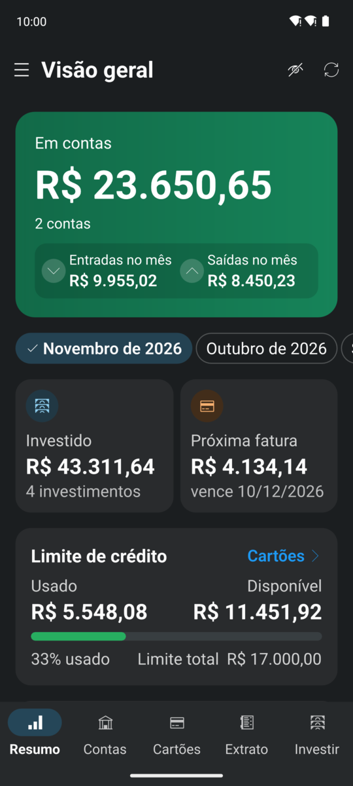
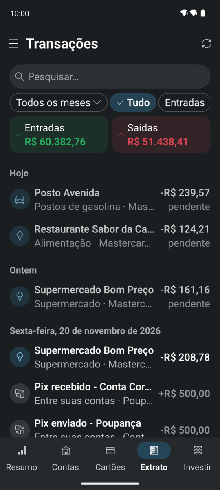
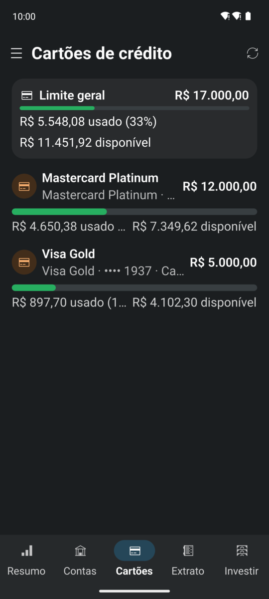
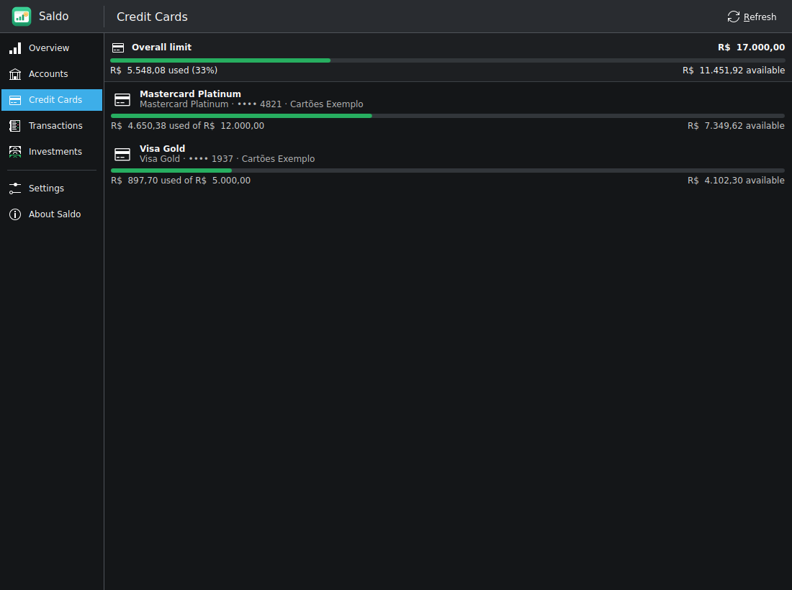
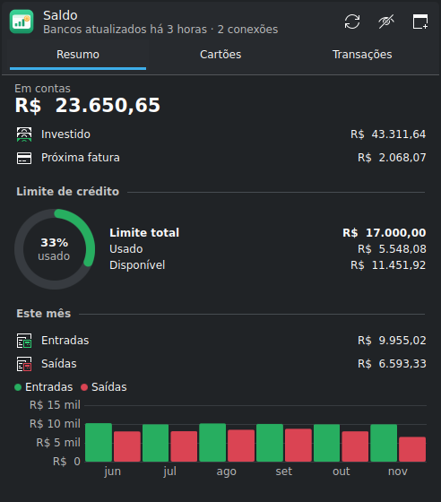

# Saldo

Suas finanças dos bancos brasileiros num só lugar: **saldos**, **cartões de crédito** (limite geral
e por cartão, próximas faturas), **investimentos** e **extrato**, com gráficos de entradas e saídas,
gastos por categoria e evolução do saldo. Os dados vêm do **Open Finance Brasil**, pela API gratuita
de uso pessoal do **Meu Pluggy**.

- **Android**: app com abas, visão geral do mês e extrato com filtros.
- **Linux**: app para o KDE Plasma (roda também no GNOME) e um **widget do Plasma 6** para ver o
  saldo e o limite direto no painel. Pacotes para Fedora, Debian e Ubuntu.
- **Sem servidor e sem conta**: o app conversa direto com a Pluggy, guarda as credenciais no
  chaveiro do sistema e mantém os dados só no seu aparelho.

Feito com Qt 6 + QML + Kirigami (KDE Frameworks 6), em português e inglês.

> Funciona só com bancos brasileiros: os dados vêm do Open Finance Brasil, com o Meu Pluggy como
> intermediário.

### No celular

|                                                           |                                                         |                                                      |
| --------------------------------------------------------- | ------------------------------------------------------- | ---------------------------------------------------- |
|  |  |  |

### No computador


|                                                     |                                                    |                                                  |
| --------------------------------------------------- | -------------------------------------------------- | ------------------------------------------------ |
|  |  |  |

## Onde roda

Cada [release](https://github.com/hernique33comiitei/saldo/releases/latest) traz o app para
**Android** (`.apk`), e o app com o widget do Plasma para **Fedora** (um `.rpm` por versão) e
**Debian / Ubuntu** (um `.deb` para cada). Antes de publicar, cada pacote é instalado e aberto numa
instalação limpa de cada versão da tabela abaixo.

### Arquiteturas

- **arm64** (ARM 64-bit, `arm64-v8a`): APK para Android
- **x86_64 / amd64** (64-bit): RPM e DEB

### Android (APK)

| Versão do Android      | Saldo 0.0.x | Saldo 0.1.x |
| ---------------------- | :---------: | :---------: |
| Android 8 ou anterior  |     ❌      |     ❌      |
| Android 9 ou mais novo |     ✅      |     ✅      |

Só o app: o widget é do Plasma (desktop).

### Fedora (RPM)

| Distribuição          | Saldo 0.0.x | Saldo 0.1.x |
| --------------------- | :---------: | :---------: |
| Fedora 41 ou anterior |     ❌      |     ❌      |
| Fedora 42             |     ❌      |     ✅      |
| Fedora 43             |     ❌      |     ✅      |
| Fedora 44             |     ✅      |     ✅      |
| Fedora 45             |     ✅      |     ✅      |

### Ubuntu / Kubuntu (DEB)

| Distribuição                 | Saldo 0.0.x | Saldo 0.1.x |
| ---------------------------- | :---------: | :---------: |
| Ubuntu 24.04 LTS ou anterior |     ❌      |     ❌      |
| Ubuntu 26.04 LTS             |     ✅      |     ✅      |
| Ubuntu 26.10                 |     ✅      |     ✅      |

Ubuntu 24.04 e anteriores não têm o KDE Frameworks 6.

### Debian (DEB)

| Distribuição             | Saldo 0.0.x | Saldo 0.1.x |
| ------------------------ | :---------: | :---------: |
| Debian 12 ou anterior    |     ❌      |     ❌      |
| Debian 13 (Trixie)       |     ❌      |     ✅      |
| Debian testing (Forky)   |     ✅      |     ✅      |

Debian 12 e anteriores não têm o KDE Frameworks 6.

## Instalação

### Fedora (RPM)

Cada release traz um `.rpm` para cada versão do Fedora: `fc42`, `fc43` e `fc44` (o `fc44` também
serve no Fedora 45 e mais novos). Baixe o da sua versão na
[página de releases](https://github.com/hernique33comiitei/saldo/releases/latest) e instale:

```sh
sudo dnf install ./saldo-*.fc44.x86_64.rpm      # troque fc44 pela sua versão (cat /etc/fedora-release)
```

### Debian / Ubuntu (DEB)

Cada release traz dois `.deb`: `-debian13` (Debian 13 e testing) e `-ubuntu26.04` (Ubuntu 26.04 LTS,
26.10 e derivados, como Kubuntu). Baixe o seu na
[página de releases](https://github.com/hernique33comiitei/saldo/releases/latest) e instale (o apt
baixa as dependências):

```sh
sudo apt install ./saldo_*-debian13_amd64.deb     # Debian
sudo apt install ./saldo_*-ubuntu26.04_amd64.deb  # Ubuntu
```

Debian 12 e Ubuntu 24.04 ou anteriores não têm o KDE Frameworks 6, que o Saldo usa: não há pacote
para eles.

### Android (APK)

Baixe `saldo-<versão>-arm64-v8a.apk` na
[página de releases](https://github.com/hernique33comiitei/saldo/releases/latest) pelo celular e
abra o arquivo (o Android pede, uma vez, para permitir instalar apps pelo navegador).

### A partir do código (Fedora)

Para desenvolver, ou para usar o `main` atual:

```sh
./install.sh                    # instala o que faltar, compila e instala em ~/.local
./install.sh --restart-plasma   # o mesmo e reinicia o plasmashell para o widget aparecer
./install.sh --deps-only        # só instala as dependências (para começar a desenvolver)
```

O `install.sh` lê as dependências do spec do Fedora (`packaging/fedora/saldo.spec`) e só pede
`sudo` quando falta algum pacote. Ele também cria
`~/.config/plasma-workspace/env/saldo.sh`, para o plasmashell achar o plugin QML do widget em
`~/.local`. O `./uninstall.sh` desfaz tudo (`--purge` também apaga o cache, as preferências e a
entrada no chaveiro).

Para testar sem conta: `saldo --demo`.

### A partir do código (outras distribuições)

As dependências ficam nos arquivos de empacotamento, a mesma lista que o GitHub Actions usa:
`debian/control` (Debian/Ubuntu) e `packaging/fedora/saldo.spec` (Fedora). Instale com o comando
padrão da sua distribuição, na pasta do código, e compile com o CMake:

```sh
sudo apt build-dep .                                # Debian/Ubuntu
sudo dnf builddep packaging/fedora/saldo.spec       # Fedora (ou ./install.sh --deps-only)

cmake -B build -G Ninja -DCMAKE_INSTALL_PREFIX=/usr && cmake --build build
sudo cmake --install build
```

Se faltar algo, o CMake para e lista os pacotes que faltam. Para rodar, também são necessários os
pacotes de execução (`Depends` do `debian/control`, `Requires` do spec): módulos QML do Kirigami e
do KQuickCharts, estilo e ícones do KDE, Qt SVG, driver SQLite do Qt e `secret-tool`.

## Conectar o Meu Pluggy

Na primeira vez, o Saldo abre um guia passo a passo (*Conectar o Meu Pluggy*, no menu lateral) com
os nomes exatos dos botões do painel da Pluggy.

O uso pessoal dá um **Client ID**, um **Client Secret** e um **ID de item** por banco conectado (não
existe um token único):

1. Crie uma conta em [meu.pluggy.ai](https://meu.pluggy.ai) e conecte os seus bancos.
2. Em [dashboard.pluggy.ai](https://dashboard.pluggy.ai), abra “Aplicações” e copie o **Client ID**
   da sua aplicação e o **Client Secret** (aparece só uma vez; se não tiver, “Credenciais” →
   “Gerar novo secret”).
3. Clique em ▶ “Iniciar Demo”, depois em “Conectar Conta”, escolha **MeuPluggy** (não o seu banco),
   entre e marque **um** banco em “Selecione a conta”. Cada autorização compartilha um único banco:
   repita para cada banco que quiser (até 5).
4. Copie o **id** de cada item em “Itens Conectados” e cole no Saldo, junto com o Client ID e o
   Secret (pelo guia ou em *Configurações*).

Guia oficial: [https://docs.pluggy.ai/pt/docs/guides/meu-pluggy-personal-use](https://docs.pluggy.ai/pt/docs/guides/meu-pluggy-personal-use)

- O Meu Pluggy atualiza os seus bancos **uma vez por dia** sozinho, e isso não pode ser forçado: o
  *Atualizar* relê o que a Pluggy já tem.
- As autorizações duram um ano (o Saldo avisa 30 dias antes). Renovar pode mudar o ID do item.

## Widget do Plasma

Clique com o botão direito no painel → *Adicionar ou gerenciar widgets* → **Saldo**, ou *Configurar
bandeja do sistema → Entradas → Saldo*. O painel mostra o ícone do Saldo ou, se você preferir, o
dinheiro nas contas (fora da bandeja do sistema). O popup tem as abas Resumo, Cartões e Transações;
o clique do meio esconde os valores. Credenciais e conexões ficam no app.

## Requisitos

O app **nunca instala** nada. Ele precisa do `secret-tool` (libsecret) para o chaveiro e mostra um
aviso quando ele falta. Os pacotes trazem todo o resto (Kirigami, KQuickCharts, Qt SVG/SQLite,
libsecret).

## Como funciona

- **Um núcleo, duas interfaces.** Uma biblioteca C++ (`saldocore`, módulo QML `org.saldo.core`)
  reúne o cliente da Pluggy, a sincronização e um cache SQLite. O app e o widget carregam essa
  biblioteca no próprio processo: não há daemon. Um arquivo de trava garante uma sincronização por
  vez, e o outro processo recarrega quando o cache muda.
- **API da Pluggy.** `POST /auth` troca o Client ID + Secret por uma chave de API, mantida 2 horas
  na memória. Contas, faturas, investimentos e categorias vêm paginados; as transações vêm do
  `GET /v2/transactions`, com cursor. Cada sincronização busca de novo os últimos 7 dias de cada
  conta, para acertar transações pendentes que mudaram ou sumiram.
- **Totais que fecham.** Os valores dos cartões são normalizados para que negativo sempre seja
  dinheiro saindo; transferências entre as suas próprias contas e pagamentos de fatura ficam fora
  de entradas e saídas; cartões que dividem o mesmo limite contam uma vez só (e qualquer cartão pode
  ser excluído).
- **Seus dados.** Client ID e Secret no chaveiro do sistema (Secret Service/KWallet), nunca em
  arquivos. Cache em `~/.local/share/saldo/` (pasta 0700, banco 0600), preferências em
  `~/.config/saldorc`. O tráfego de rede vai só para `https://api.pluggy.ai`.
- **Idioma.** Português ou inglês, em *Configurações → Idioma* (por padrão, o do sistema).
- **Tema.** Claro ou escuro, em *Configurações → Aparência* (por padrão, o do sistema: as cores do
  Plasma, ou o modo escuro do GNOME ou do celular).
- **Interface.** No desktop, os controles do KDE, que seguem o tema do Plasma. No celular, um visual
  próprio: cartões, abas com destaque, painéis que sobem de baixo e campos preenchidos. Os dois vêm
  do design system do app (`src/app/ui/`, módulo QML `org.saldo.ui`); `saldo --demo --page gallery`
  mostra o catálogo dos componentes.

> A documentação da Pluggy é ambígua sobre a unidade dos valores e o sinal das compras no cartão;
> os dados reais vieram em reais e com as compras do cartão positivas, que o Saldo converte em
> dinheiro saindo. *Configurações → Dados brutos…* mostra o JSON de cada conta para comparar com o
> app do banco.

## Android

O app (não o widget) roda no Android, com as credenciais no Android Keystore. Os APKs são
compilados com o KDE Craft no contêiner Android do KDE: `tools/build-apk.sh --docker` gera um
localmente e `tools/sign-apk.sh` assina. A configuração da assinatura está no `CLAUDE.md`.

## Licença

MIT: veja [LICENSE](LICENSE). O Saldo é um projeto independente, sem vínculo com a Pluggy.
